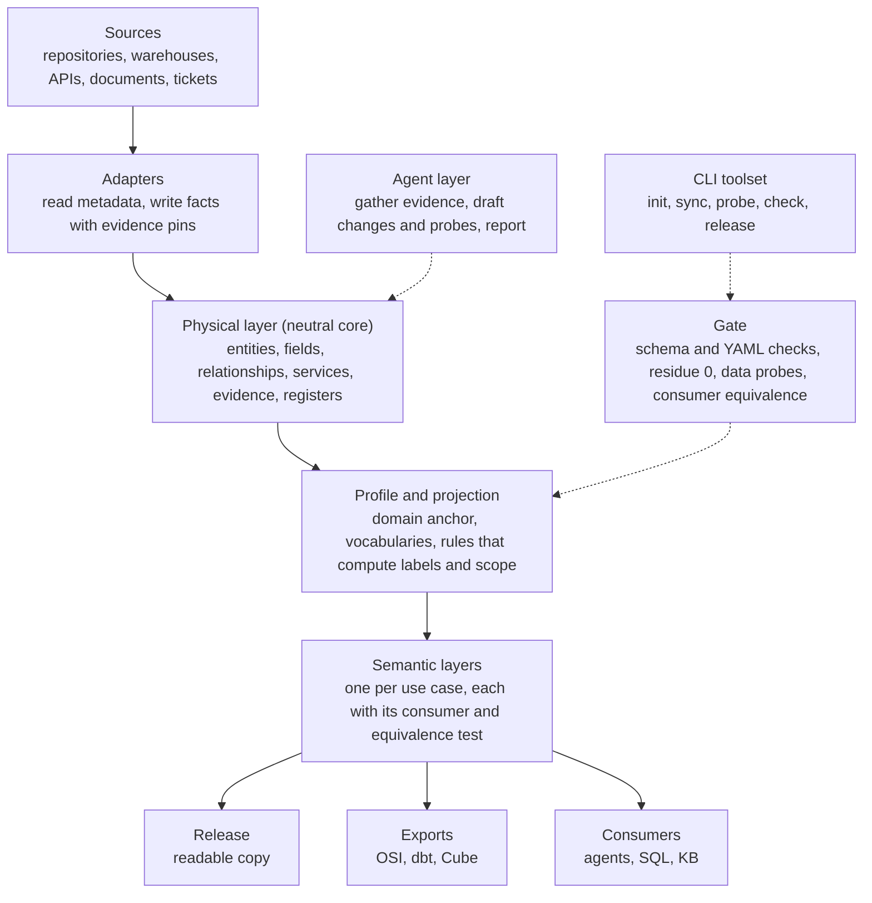

# FactModel - Product Specification

Author: Oleksandr Sluchyk · Version 0.1 · 2026-10-23

## Summary

FactModel is a framework that lets AI agents build, check and keep current a semantic model of any data platform. It ships schemas, a specification, agent instructions and skills, and a small command-line toolset. Every fact in a model carries its evidence, and every derived value is computed, never typed by hand.

The model has two kinds of layers. One **physical layer** describes what exists: sources, tables, fields, keys, relationships, services. Any number of **semantic layers** sit on top, one per use case, each proven correct by the consumer that uses it.

**Companion documents.** This specification is version 0.1 (`spec-v0.1`). It is completed by:

- [`VOCABULARY.md`](VOCABULARY.md) - every term and enumeration, defined once; the code and schemas load its lists.
- [`ALGORITHMS.md`](ALGORITHMS.md) - projection, subject scope closure and release partition, with test vectors in `tests/vectors/`.
- [`../schemas/`](../schemas/README.md) - one JSON Schema per file kind; the valid fixtures in `tests/fixtures/schemas/` are the normative examples.
- [`IMPLEMENTATION_PLAN.md`](IMPLEMENTATION_PLAN.md) - milestones and work packages.
- [`../decisions/`](../decisions/README.md) - why the framework is the way it is.

**Why the name.** FactModel is a model made of facts about a data platform, each with its evidence: where it came from, which version was read, and how sure it is. Semantic layers stand on those facts instead of on what someone remembers.

## Problem and principles

A schema tells an agent what columns exist. It does not tell it which join is safe, which row is current, which column is stale, or which rule the platform applies silently. Agents that guess these things write SQL that runs and returns wrong answers.

Semantic-layer tools (dbt MetricFlow, Cube, warehouse semantic views) and the Open Semantic Interchange standard define metrics and dimensions. They assume the facts underneath are already known. FactModel produces and maintains those facts, with proof, and can export them to those tools.

**Principles**

1. **Evidence or it does not exist.** Every authored fact names its source, a pin (commit, API endpoint, dataset, document version) and a status: confirmed, inferred, unresolved or retracted.
2. **Derived values are never authored.** Labels, scopes and summaries are computed by deterministic code from authored facts.
3. **The core is neutral.** No domain word appears in the core schema. Domain meaning lives in a profile.
4. **No universal semantic layer.** One semantic layer per use case. The framework gives the contract, not the meaning.
5. **A consumer proves the model.** A layer is correct when its consumer gets the same answers as the platform does.
6. **Agents propose, code decides.** Agents gather evidence and draft changes; scripts validate and compute; a person approves what cannot be undone.
7. **Mistakes stay visible.** Retractions are named and kept. Nothing is silently deleted from the record.
8. **No data in the repository.** Probes return counts and shapes, never rows.
9. **The core never names an engine; adapters are plugins behind one snapshot contract.** Any data source an adapter can describe as a snapshot can be modelled (D-011).

## Scope

**Goals**

- Build a physical layer for a new platform in days, from metadata plus evidence, with an agent doing most of the work.
- Keep it current: detect drift, re-measure on triggers, show what changed and why.
- Let teams add semantic layers for their own use cases on a shared, trusted base.
- Share a clean, readable release of the model without the tooling.
- Work on any engine through adapters, and any domain through profiles.

**Non-goals**

- A query engine, BI tool or metrics server. FactModel exports to those.
- A data catalog UI. It may generate static pages, nothing more.
- Running probes against production by itself. People or CI with credentials run them.
- Storing data samples, credentials or personal data.
- Linking entities across platforms into one graph. Version 1.0 is one model per platform; cross-model links come later.

**Users**

| Who | What they do |
| --- | --- |
| Model owner | Approves decisions, runs probes, commits, publishes releases |
| AI agent | Gathers evidence, drafts model changes, writes probes, reports |
| Contributor | Adds a semantic layer, a profile or an adapter |
| Consumer | An agent, SQL generator or knowledge base that reads a release |

## Concepts

The model is plain files (YAML and Markdown) in git. Six concepts carry it. Every term and enumeration is defined once in [`VOCABULARY.md`](VOCABULARY.md).

**Source registry.** The memory of where facts come from: repositories, warehouses, APIs, documents, ticket systems. Each source has an id, a kind, an access mode (`agent_read`, `owner_read`, `export_file`), a pin format and a rank (lower wins). Ranks resolve conflicts: configuration beats a vendor document, a document beats a verbal answer. Credentials are never stored, only how to obtain them.

**Physical layer.** What exists on the platform.

| Element | Key attributes |
| --- | --- |
| Entity | id, physical name, grain, keys, class (data, configuration, administrative, reference), anchor reference (the field that holds the anchor key, if any), current-row rule, status (draft, reviewed, deprecated). Subject scope (direct, transitive, none) is computed, not authored (D-007) |
| Field | name, path for nested fields, type, nullable, repeated, meaning, known hazards |
| Relationship | key, from, to (one target, or a target set with a discriminator or per-tenant choice), join, mechanism (declared foreign key, inferred join, derivation, representation), cardinality, meaning, scope admission (the basis that lets subject scope pass through it) |
| Service | kind (pipeline, scheduled job, application, manual), what it reads and writes, when |
| Tenant / environment | two separate facts: `ingest` (what the configuration accepts) and `presence` (what the data shows), measured per environment |

**Semantic layer.** A named set of concepts and measures for one use case, built only on physical facts referenced by ID (D-019). Each layer declares its consumer and the equivalence test that proves it. A consumer must apply every entity's current-row rule, the default filters and every required concept; the layer lists them, with the hazards it inherits and what each measure does with suppressed cells, so nothing is applied from memory. The gate stage `layers` checks the contract (`spec/VOCABULARY.md`, section 9).

**Evidence.** Attached to every authored fact: source id, pin, quote or measurement, status, date read (`read_on`). A probe result is evidence too; it also records the probe, the environment and the quality of that data (representative, synthetic, unknown). Only a result on representative data confirms a fact; a result on synthetic or unknown data is kept as `inferred` evidence (D-014). Superseded: the earlier rule that a zero-violation result on test data carries over to production. Example models whose platform is itself synthetic may set `treat_synthetic_as_representative: true`. Fields inherit their entity's metadata evidence unless they override it.

**Registers.** Findings (problems to fix), escalations (questions for people, closed only by an answer with evidence), hazards (permanent behaviour a reader must know), decisions (why the model is the way it is, including retractions).

**Profile.** The domain layer over the neutral core: the subject (customer, patient, account; the model binds the anchor entity that holds it, D-012), vocabularies, and ordered projection rules that turn facets into domain labels. A profile may have no subject when no row is about an individual (D-015). Example profiles: retail, statistics, healthcare payer, banking.

## Architecture

Facts flow down from sources to consumers. Agents and the gate work beside that flow, never inside it.



| Component | Job | Ships as |
| --- | --- | --- |
| Core schemas | JSON Schema for every file kind: entity, relationship, source, evidence, register entry, profile, layer | `schemas/` |
| Adapters | Read a source's metadata (`INFORMATION_SCHEMA` exports, live reflection, DDL in git) into an engine-neutral snapshot | Python plugins in the entry-point group `factmodel.adapters` |
| Projection library | Computes labels, subject scope, current-row reads, residue | Python package, no I/O |
| Profiles | Subject role, vocabularies, rule tables; the model binds the anchor entity (D-012) | YAML |
| Gate | Runs every check; one command, one verdict | `fact check` |
| Probe generator | Writes data probes from the model (see Validation) | `fact probe` |
| Release projection | Allowlist per file kind; fail-closed on unknown keys | `fact release` |
| Exporters | OSI / Apache Ossie, dbt semantic models, Cube | `fact export` |
| Agent layer | `AGENTS.md`, skills, prompt templates | Markdown |

Built-in adapters (D-011): `export` (owner-exported standard `INFORMATION_SCHEMA` views, any engine that has them), `sql` (live reflection through SQLAlchemy, any engine with a SQLAlchemy dialect) and `git` (DDL and text in a repository, any dialect sqlglot parses). The reference engines are SQLite, PostgreSQL and DuckDB (DuckDB since M2, through `sql`; when a SQLAlchemy dialect cannot reflect, `sql` reads the standard `INFORMATION_SCHEMA` views instead); cloud engines are reached through `export` or `sql` by adopters with their own credentials.

## Validation

Validation runs at three levels. Each level catches mistakes the one before cannot see.

**1. Static gate (files only, runs on every change).**

- Strict YAML: duplicate keys fail.
- Every file matches its schema; unknown keys fail.
- Every authored fact has evidence; no derived value is authored.
- Projection residue is 0: every relationship gets a label or an explicit `withheld`.
- Every entity a consumer declares is reachable from the anchor, or carries an owner decision.
- Registers are consistent: no closed escalation without an answer and evidence; hazards never counted as issues.
- The release partition is complete: every file has exactly one disposition.

**2. Generated data probes (run by a person or CI with credentials).** The model writes its own tests. For each fact that data can confirm, `fact probe` generates a SQL check in the engine's dialect:

| Model fact | Generated probe |
| --- | --- |
| Declared key | Duplicate count on the key |
| Join | Match rate and orphan count, both directions |
| Cardinality | Fan-out per source row |
| Transitive scope | Source rows reaching more than one anchor |
| Current-row rule | Rows per key after the rule; ties |
| Field meaning | Null rate, value set vs vocabulary |
| Environment presence | Row count per tenant and environment |

Probes return counts only. Results are saved with a pin (engine, dataset, date) and become evidence. A probe that fails opens a finding automatically.

**3. Consumer equivalence.** Each semantic layer names its consumer and a corpus of real requests. The test runs the consumer on the corpus and compares its output with the platform's own answer. The layer is accepted at an agreed threshold, and any drop blocks a release.

## Keeping it current

The model goes stale in three ways: the platform changes, a source changes, or a person answers a question. FactModel handles each with a trigger, not a calendar alone.

1. **Sync.** `fact sync` re-reads every source at its current version and diffs the facts against their pins. New tables, dropped columns, changed types and moved commits become a drift report.
2. **Classify the drift.** Each item is one of: new fact (agent drafts it), changed fact (evidence must be renewed), lost fact (finding), no effect.
3. **Re-probe.** Only the probes whose facts changed are regenerated and queued for the owner.
4. **Triggers.** A maintenance file lists events and what each one requires: a new tenant, a source pin move, an escalation answered, a ticket shipped, a probe result outside its range. The gate fails when a fired trigger has no follow-up.
5. **Maintenance pack.** A scheduled full re-measure of environment presence and the probes marked as volatile (`fact probe generate --set volatile`).

Every change lands in git with a changelog entry that says *why*, not only *what*.

## Agent layer

The agent layer is plain Markdown that any capable coding agent can follow. It works with Claude Code skills and with any tool that reads `AGENTS.md`.

**`AGENTS.md`** holds invariants only: evidence rules, what never gets authored, when to stop and ask, how to report. Procedures live in skills.

**Skills**

| Skill | Started by | Does |
| --- | --- | --- |
| `model-onboard` | owner | First pass on a new platform: register sources, run adapters, draft entities |
| `entity-scaffold` | owner | One new entity with fields, keys and relationships, evidence attached |
| `evidence-gather` | agent | Find and quote the highest-rank source for a claim |
| `probe-write` | agent | Generate and explain probes for a set of facts |
| `probe-intake` | owner | Read probe results, update evidence, open findings |
| `drift-review` | owner | Work through a sync report |
| `layer-build` | owner | Build a semantic layer for one consumer, with its equivalence corpus |
| `escalation-draft` | agent | Turn an open question into a short message for the right people |
| `maintenance-pack` | owner | Run the scheduled re-measure and take its results in |
| `release` | owner | Run the release projection and prepare notes for readers |
| `model-lookup` | consumer | Answer questions from a release, citing files |

**Guardrails**

- Stop when a measurement contradicts a documented fact, or when a change cannot be undone.
- Never close an escalation without a named answer source.
- Never commit, push or publish; the owner does.
- Work in rounds: one brief in, one report out, with confirmed / inferred / unknown kept apart.

## Toolset

One command, `fact`, with a few verbs. It is a small Python package run through `uv`; no server, no database.

| Command | Does |
| --- | --- |
| `fact init --profile <name>` | Create a model repository with the layout, schemas and agent files |
| `fact source add` | Register a source: kind, access mode, rank, pin format |
| `fact adapters` | List the installed adapters, the engines they read and their default dialects |
| `fact export-sql --source <id>` | Print the SQL the owner runs to export a source's metadata |
| `fact snapshot --source <id>` | Write a source's metadata to a snapshot file, so agents and tests work without credentials |
| `fact draft --source <id>` | Turn the latest snapshot into entity drafts in `drafts/` |
| `fact sync [--source <id>]` | Run adapters, write new facts, produce a drift report |
| `fact probe generate` | Write probe scripts for the facts that need data proof |
| `fact probe run --source <id>` | Run probes through the `sql` adapter where the source names a `dsn_env` (counts only) |
| `fact probe intake <file>` | Turn probe output into evidence and findings |
| `fact check` | Run the gate; exit 0 only when every stage passes |
| `fact migrate` | Report the schema version a model uses and whether the installed framework reads it (`spec/VERSIONING.md`) |
| `fact project` | Recompute derived values (labels, scope, generated tables) |
| `fact --version` | The framework version and the schema version it reads |
| `fact release --out <dir> --version <v>` | Build the readable release copy: complete partition, internal notes stripped, `VERSION`, append-only `RELEASE_NOTES.md`; refused on a failing gate or an equivalence drop |
| `fact check --release <dir> [--previous <dir>]` | The reduced gate for a release: yaml, schema, references, privacy, and the release stage |
| `fact lookup --layer\|--entity\|--hazard <id>` | Print a layer with its joins resolved, an entity or a hazard, from a model or a release |
| `fact equivalence run\|accept\|script` | Run a layer's consumer on its corpus and compare with the references (counts and outcomes only); accept a run (owner); write an owner-run live comparison script |
| `fact export --target ossie\|dbt --layer <id> --out <dir>` | Export a semantic layer to another tool, with `EXPORT_NOTES.md` listing what the target cannot hold (`docs/exporters/round-trip-notes.md`) |
| `fact status` | Open findings, fired triggers, stale evidence, next actions |

Probe scripts are plain shell with SQL inside, so the owner can read them before running.

## Repository layout

Two repositories: the framework, and one model repository per platform that uses it.

```text
factmodel/                  framework
  spec/                     this specification, versioned
  schemas/                  JSON Schema per file kind
  src/factmodel/            Python package: core, projection, gate, probe, release, export, adapters
  profiles/                 retail/, statistics/, ... (examples)
  agent/                    AGENTS.md template, skills/, prompt templates
  examples/chinook/         a full model of the Chinook schema on SQLite and PostgreSQL
  examples/qcew/            BLS QCEW: no subject, code-prefix hierarchies, BLS code lists (M2)
  decisions/, rounds/       decision records; briefs and reports

<platform>-model/           one per platform
  factmodel.yaml            framework version, profile, adapters, consumers
  sources/                  source registry; snapshots/ holds exported metadata
  physical/                 entities/, services/, tenants.yaml
  semantic/<layer>/         layer files and corpus/ (synthetic or redacted requests)
  registers/                findings, escalations, hazards, decisions
  evidence/                 probe results and quotes, counts only
  probes/                   generated probe scripts, read before running
  drafts/                   adapter and agent proposals, never read by the gate
  maintenance/              triggers and the maintenance-pack definition
  generated/                derived files, never edited by hand
  release/                  allowlist, release log and authored reader docs
  CHANGELOG.md, AGENTS.md, .claude/skills/
```

The framework version is pinned in `factmodel.yaml`. A model repository upgrades on purpose, with a migration note.

## Security and privacy

- **No data, no secrets.** Probes print counts, rates and lengths, never values or identifiers. The gate scans evidence files for patterns that look like personal data and fails on a match.
- **No credentials in the repository.** Sources record how access is obtained, not the secret.
- **People are not named in the model.** Probe output may contain user emails from job history; intake strips them before anything is written.
- **Release is fail-closed.** Only allowlisted keys and files leave the model repository. Internal notes use explicit markers, never pattern matching on prose.
- **Agents read, people run.** Agents never execute queries against production. They write the probe; a person with access runs it.
- **Corpora are not data.** An equivalence corpus in the repository holds synthetic or redacted requests. A real corpus stays outside and is referenced by a pin.

## Roadmap and acceptance

Each milestone ends at a gate. The core schema is frozen only after M2, when a second engine and a second domain pass without changing it.

| Milestone | Builds | Gate |
| --- | --- | --- |
| M0 - Specification | spec, JSON Schemas, profile contract, projection algorithm | spec reviewed; every rule has a worked example |
| M1 - Core, engine-neutral | core package, gate, adapter protocol, `export`, `sql` and `git` adapters, probes rendered per dialect, retail profile, Chinook example on SQLite and PostgreSQL | residue 0; expected scopes hold (Invoice direct, InvoiceLine transitive, catalog tables reference); the same probes give the same counts on both engines |
| **M2 - Cloud engines by adopters and a second domain** (done: schemas 1.0.0) | BigQuery verified through `export` and `sql` by an adopter on their own project (owner-pending); third-party adapter guide; second domain profile (`statistics`, QCEW) | every core change in the ledger with its record (D-018: removals, renames and meaning changes need a decision; additions a ledger line) |
| M3 - Semantic layers (done on synthetic corpora: rounds 20 to 25) | layer contract, probe generator, equivalence harness, OSI and dbt export | one real consumer meets its equivalence threshold on a real corpus (two reference consumers met it on synthetic corpora; the real corpus is the M4 pilot) |
| M4 - Release 1.0 | packaging, guides, examples, upgrade notes | someone else sets up a model repository from scratch using only the docs |

The reference dataset is Chinook, schema only, with synthetic rows generated at test time (D-011): it has a clear anchor (`Customer`), a direct link (`Invoice`), a transitive one (`InvoiceLine`), administrative data (`Employee`), a reference chain (`Track` to `Album` to `Artist`) and a bridge between reference entities (`PlaylistTrack`).

## Later, not in 1.0

- `fact serve`: an MCP server over a release, so consumer agents query the model instead of reading files.
- Writer-attribution probes from warehouse job history: who wrote or deleted rows, when, and by which statement.
- Cross-model links between platforms.
- Snowflake and Databricks verified through the `export` and `sql` adapters by adopters.
- Candidate adapter plugins: dbt manifest, OpenMetadata, DataHub.

## Open questions

- [x] License: Apache 2.0 (D-001). Models built with FactModel stay private to their owners.
- [x] Package name: `factmodel` for the distribution and the import, command `fact` (D-010).
- [ ] Name: trademark check before the first public push.
- [ ] Second domain for M2: which open-source application schema (needs a clear anchor and both reference and unanchored data).
- [x] Equivalence threshold: 0.9 by default, per consumer when the owner sets `threshold` (D-021).
- [x] Export target priority: both in M3 (round 25); dbt validated with `dbt parse`, Ossie structural until its specification is pinned to a version.
- [ ] Format of facts: YAML files only, or YAML plus a generated graph file (for example JSON-LD) for graph consumers.

## Sources

- [Thoughtworks Technology Radar: Semantic layer (Apr 2026)](https://www.thoughtworks.com/en-ec/radar/techniques/semantic-layer)
- [Apache Ossie (formerly Open Semantic Interchange)](https://ossie.apache.org/)
